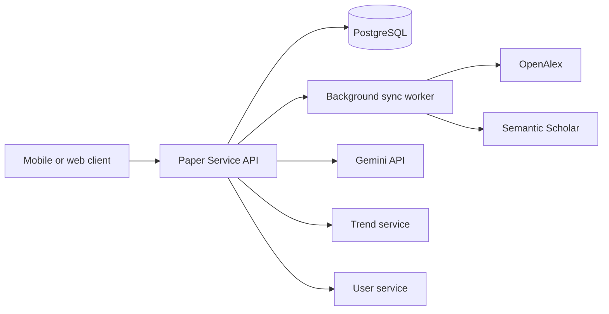

# Paper Service

Backend service for collecting, searching, and analyzing academic papers in the Journal Trend Tracker system.

> **Team project.** This service was split from a shared microservices codebase. I authored 33 of the 50 visible commits in this repository and document my own work below.

## Overview

Paper Service provides a REST API for paper discovery, search, suggestions, synchronization from external scholarly sources, PDF analysis, and research-gap analysis.

## Main features

- Search, filter, paginate, and retrieve paper details
- Keyword, journal, and author suggestions
- Background synchronization from OpenAlex and Semantic Scholar
- PostgreSQL persistence with Entity Framework Core migrations
- PDF upload and AI-powered deep analysis
- Research-gap matrix analysis using a hybrid DB and OpenAlex search flow
- Swagger API documentation, Docker build, and health-check endpoints

## Tech stack

| Category | Technology |
|---|---|
| Runtime | .NET 8, ASP.NET Core Web API |
| Data | PostgreSQL, Entity Framework Core, Npgsql |
| Documentation | Swagger / OpenAPI |
| Background processing | Hosted service / `BackgroundService` |
| External data | OpenAlex, Semantic Scholar |
| AI | Gemini API |
| Deployment | Docker, Render-compatible configuration |

## Architecture



## My contributions

- Implemented and maintained Paper Service infrastructure, entities, database context, migrations, search, and pagination.
- Built background synchronization workers for OpenAlex and Semantic Scholar.
- Added PDF deep analysis and AI-assisted research-gap matrix analysis.
- Fixed production issues involving database migration, CORS, dependency injection, disposed service scopes, API payload validation, and Render deployment limits.
- Collaborated through feature branches, merges, and conflict resolution.

## Run locally

### Prerequisites

- .NET 8 SDK
- PostgreSQL
- API keys for Gemini and, if needed, Semantic Scholar

### Setup

```bash
git clone https://github.com/S-bon-debug/PRN_PaperService.git
cd PRN_PaperService
cp .env.example .env
# Update .env with local database credentials and newly issued API keys.
dotnet restore
dotnet run
```

The service applies Entity Framework Core migrations during startup. Swagger is available from the local application URL, and health checks are exposed at `/health` and `/api/papers/health`.

## Docker

```bash
docker build -t paper-service .
docker run --env-file .env -p 8080:8080 paper-service
```

## Security

- Keep secrets in `.env`; the file is excluded by `.gitignore`.
- Use `.env.example` only as a template.
- Never commit API keys, database passwords, or production connection strings.

## Team-project note

This repository includes work from several contributors. I do not claim ownership of other members' work; the Git history is available for individual attribution.
